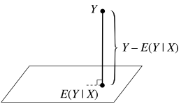

> 这一章围绕随机变量的数学性质展开, 从描述中心与波动的期望与方差开始, 到表达高阶性质的矩, 再引入条件介绍条件期望与方差, 最后讨论刻画随机变量间关系的协方差.

## Expectation and Variance

### Expectation

期望 $E(\cdot)$ 可以理解为一个函数, 将服从一定分布的随机变量映射到一个数值上, 用于刻画随机变量的中心.

离散型随机变量的期望定义为 

$$
E(X)=\sum^{\infty}_{j=1}x_jP(X=x_j)
$$

连续型随机变量的期望定义为

$$
E(X)=\int_{S}xf_X(x)\,dx
$$

其中 $S$ 指支撑集.

并不是所有随机变量都具有期望. 离散型期望数学形式上是级数, 连续型是积分, 只有当它们绝对收敛时, 期望的存在性才能得到保证. 一个典型的例子是, [Random Variables and Distributions](/note/mathematics/probability/random-variables-and-distributions/) 中介绍的服从 [Cauchy](/note/mathematics/probability/random-variables-and-distributions/#cauchy) 分布的随机变量就不存在期望

#### Linearity

期望最重要的性质之一是线性性, 即

$$
E(aX+bY)=aE(X)+bE(Y)
$$

它是我们在计算期望时采取的许多手段 (例如示性随机变量) 的前提.

#### Law of the unconscious statistician

无意识统计学家定理给出无需先求出 $Y=g(X)$ 的分布, 而可以直接计算分布期望的方法. 

对于离散型有 

$$
E(g(X))=\sum_x g(x)P(X=x)
$$

对于连续型则有
$$
E(g(X))=\int_{S}g(x)f_X(x)\,dx
$$

该定理考虑样本点与随机变量之间的映射关系即可证明.

#### Mean and Median

除期望也即 $mean$ 外, 中位数, 即 $median$  也是一种衡量"中心"的方法. 

事实上, 期望是使得均方误差 $E((X-c)^2)$ 最小的取值方法, 而中位数是绝对误差 $E(|X-c|)$ 最小的取值方法. 由于并非重点, 这里不展开具体的证明过程.

### Variance

方差 $Var(\cdot)$ 与 $E(\cdot)$ 一样可以理解为一个函数, 用于映射随机变量到其波动.

使用期望定义方差为 

$$
Var(X)=E((X-E(X))^2)=E(X^2)-(E(X))^2
$$
对该定义的理解是, $X$ 偏离均值 $E(X)$ 的二范数平方的期望. 

有时, 我们希望消去平方影响, 于是定义标准差

$$
SD(X)=\sqrt{Var(X)}
$$

#### Properties

将 $X$ 系统性偏移 $c$ 并不会影响 $X$ 的波动性, 即 

$$
Var(X+c)=Var(X)
$$

而对 $X$ 做伸缩时, 平方的缘故使得影响会被放大, 即
$$
Var(cX)=c^2Var(X)
$$
对于 $Var(X+Y)$, 借助下面 $Covariance$ 小节会有 
$$
Var(X+Y)=Cov(X+Y,X+Y)=Var(X)+Var(Y)+2Cov(X,Y)
$$
当 $X,Y$ 独立时有 $Cov(X,Y)=0$ (在 $Covariance$ 小节证明), 则
$$
Var(X+Y)=Var(X)+Var(Y)
$$

---
## Moment

### Interpretation

#### Kinds

对于随机变量 $X$, 假设其期望 $E(X)=\mu$, 方差 $Var(X)=\sigma^2$. 

其 $n$ 阶矩定义为 $E(X^n)$, 其 $n$ 阶中心矩消除中心影响, 定义为 $E((X-\mu)^n)$, 其 $n$ 阶标准矩进一步消除波动影响, 定义为 $E((\frac{X-\mu}{\sigma})^n)$.

特别的, 一阶矩是期望, 二阶中心矩是方差.

#### Skewness and Kurtosis

偏度用于刻画分布的对称性, 被定义为三阶标准矩, 即

$$
Skew(X)=E\left(\left(\frac{X-\mu}{\sigma}\right)^3\right)
$$
正的偏度意味着分布的 $PDF$ 有较长右尾的倾向, 负的偏度则情形相反.

峰度刻画尾部的厚重程度,被定义为四阶标准矩的派生, 即
$$
Kurt(X)=E\left(\left(\frac{X-\mu}{\sigma}\right)^4\right)-3
$$
减去 $3$ 的原因是保持正态分布有 $0$ 峰度作为基准.

### MGF

> A generating function is a clothesline on which we hang up a sequence of numbers for display —— Herbert Wilf

随机变量 $X$ 的矩母函数 （$moment$ $generating$ $function$）被定义为一个关于 $t$ 的函数
$$
M(t)=E(e^{tX})
$$
若它在开区间 $(-a,a)$ 上均有限, 则称矩母函数存在, 否则矩母函数不存在. 其中 $t$ 是任意引入的一个变量.

#### Moments via derivatives of the MGF

给定随机变量的 $MGF$, 我们可以计算 $X$ 的任意 $n$ 阶矩 :

$$
\begin{aligned}
& M(t)=\sum^{\infty}_{n=0}M^{(n)}(0)\frac{t^n}{n!} \\
& M(t)=E(e^{tX})=E(\sum^{\infty}_{n=0}X^{n}\frac{t^n}{n!})=\sum^{\infty}_{n=0}E(X^n)\frac{t^n}{n!} \\
\end{aligned}
$$
由此可以得到 $E(X^n)=M^{(n)}(0)$

#### MGF determines the distribution

一个随机变量的矩母函数决定了随机变量的分布, 因而如果两个随机变量具有相同的 $MGF$, 则它们具有相同的分布. 事实上, 只需要在一小段区间 $(-a,a)$ 上有相等的 $MGF$, 则两个随机变量就必须有相同的分布. 

这是分析学上很难的一个定理, 这里不做证明展开. 但该定理对于研究经过复杂运算和变换后服从的分布具有重要作用. 

例如对多个独立随机变量之和, 我们可以通过 $M_{X_1+\cdots+X_n}(t)=\prod_i M_{X_i}(t)$ 计算出随机变量之和的矩母函数, 进而确认其分布

#### MGFs of general distributions
|           分布            |           矩母函数 $M_X(t)=\mathbb{E}[e^{tX}]$           |       存在范围       |
| :---------------------: | :--------------------------------------------------: | :--------------: |
|     $Bernoulli(p)$      |                      $1-p+pe^t$                      | $t\in\mathbb{R}$ |
|     $Binomial(n,p)$     |                    $(1-p+pe^t)^n$                    | $t\in\mathbb{R}$ |
|     $Geometric(p)$      |              $\dfrac{pe^t}{1-(1-p)e^t}$              |  $t<-\ln(1-p)$   |
|   $Poisson(\lambda)$    |          $\exp\left(\lambda(e^t-1)\right)$           | $t\in\mathbb{R}$ |
|     $Uniform(a,b)$      | $\dfrac{e^{tb}-e^{ta}}{t(b-a)}$（$t\ne 0$）；$M_X(0)=1$ | $t\in\mathbb{R}$ |
| $Exponential(\lambda)$  |             $\dfrac{\lambda}{\lambda-t}$             |   $t<\lambda$    |
| $Gamma(\alpha,\lambda)$ |   $\left(\dfrac{\lambda}{\lambda-t}\right)^\alpha$   |   $t<\lambda$    |
| $Normal(\mu,\sigma^2)$  |   $\exp\left(\mu t+\dfrac{\sigma^2t^2}{2}\right)$    | $t\in\mathbb{R}$ |
|   $Chi-Squared(\nu)$    |                  $(1-2t)^{-\nu/2}$                   | $t<\dfrac{1}{2}$ |
|  $Beta(\alpha,\beta)$   |                        无初等形式                         | $t\in\mathbb{R}$ |
|  $Cauchy(x_0,\gamma)$   |                         不存在                          |  不存在包含 $0$ 的开邻域  |

---
## Conditional Expectation and Variance

> 在谈及条件期望时, 一般分为给定事件的条件期望与给定随机变量的条件期望. 后者是本节将要重点讨论的.
### Conditional Expectation given an event

给定事件的条件期望一般写作 $E(Y|A)$, 描述当我们知晓事件 $A$ 后, 对于随机变量 $Y$ 期望的更新值. 引入条件概率即可自然地形式化定义给定事件的条件期望, 即

$$
E(Y|A)=\sum_y yP(Y=y|A) \,\, \text{或} \,\, E(Y|A)=\int_S yf(y|A)\,dy 
$$
其中 $f(y|A)$ 由混合版本的 $Bayes$ 公式给出

$$
f(y|A)=\frac{P(A|Y=y)f_Y(y)}{P(A)}
$$

#### Law of total expectation

由全概率公式可以得到全期望公式 (以离散型为例) :

$$
\begin{aligned}
E(X)&=\sum_x xP(X=x)=\sum_x x(\sum_i P(X=x|A_i)P(A_i)) \\
&=\sum_iP(A_i)\sum_x xP(X=x|A_i)=\sum_iE(X|A_i)P(A_i)
\end{aligned}
$$

### Conditional Expectation given a RV

给定随机变量的条件期望一般记作 $E(Y|X)$, 描述我们已知随机变量 $X$ 的信息时, 对随机变量 $Y$ 的期望做的更新. 这种更新会随着已知随机变量取值的变化而变化. 

换句话说, 给定随机变量的条件期望本身可以视为随机变量 $g(X)$. 事实上, 定义 $g(x)=E(Y|X=x)$, 给定 $X$ 的 $Y$ 期望即定义为随机变量 $g(X)$, 记作 $E(Y|X)$. 

#### Dropping independent

如果 $X,Y$ 独立, 则 $E(Y|X)=E(Y)$, 即已知 $X$ 的信息无法提供 $Y$ 期望的新信息

#### Taking out what's known

对于任意函数 $h(\cdot)$ 有 $E(h(X)Y|X)=h(X)E(Y|X)$, 当 $X=x$ 给定后, $h(X)$ 退化为常量可直接分离到 $E(\cdot)$ 外

#### Linearity

继承自期望的线性性, 有 $E(aY_1+bY_2|X)=aE(Y_1|X)+bE(Y_2|X)$.

#### Adam's law

对于任意随机变量 $X,Y$, 都有 
$$
E(E(Y|X))=E(Y)
$$
以离散型为例, 使用全期望公式证明如下

$$
E(Y)=\sum_xE(Y|X=x)P(X=x)=E(E(Y|X))
$$
直观的理解是, 基于 $X$ 的计算的 $Y$ 的条件期望按 $X$ 平均, 就能获得 $Y$ 原本的期望

#### Projection Interpretation

$E(Y|X)$ 在几何意义上是 $Y$ 向所有 $X$ 的函数构成的空间的投影

形式化表达 :
$$
\begin{aligned}
E(h(X)(Y-E(Y|X)))&=E(h(X)Y)-E(h(X)E(Y|X)) \\
&=E(h(X)Y)-E(E(h(X)Y|X))=0
\end{aligned}
$$
最后一步由 $Adam's$  $law$  得到.

### Conditional Variance

基于给定随机变量的条件期望, 我们可以很自然的定义出条件方差 : 

$$
Var(Y|X)=E((Y-E(Y|X))^2|X)=E(Y^2|X)-(E(Y|X))^2
$$

#### Eve's law

对于任意随机变量 $X,Y$, 都有 

$$
Var(Y)=E(Var(Y|X))+Var(E(Y|X))
$$
令 $g(X)=E(Y|X)$证明如下 :

$$
\begin{aligned}
E(Var(Y|X))&=E(E(Y^2|X)-g(X)^2)=E(Y^2)-E(g(X)^2) \\
Var(E(Y|X))&=E(g(X)^2)-E(g(X))^2=E(g(X)^2)-(E(Y))^2
\end{aligned}
$$
对于该公式直观的理解是, 将 $Y$ 按照 $X$ 分组, $E(Var(Y|X))$ 求出多个组内方差的均值, $Var(E(Y|X))$ 求出组间方差(每个组以自身均值为代表), 而总体方差等于组内和组间方差之和.

由 $Y=(Y-E(Y|X))+E(Y|X)$ 并独立随机变量方差之和的性质, 可得到 $Eve's$ $law$ 的另一种形式
$$
Var(Y)=Var(Y-E(Y|X))+Var(E(Y|X))
$$

此时表达 $Y$ 的方差等于投影分量方差与垂直分量方差之和.

---
## Covariance 

> 在本章前面小节中介绍的一系列概率学对象, 主要研究单个随机变量的性质, 或是引入其他随机变量的条件研究单个随机变量的性质, 而本节介绍多维随机变量之间线性关系的刻画.

### Covariance
协方差的核心动机是衡量随机变量是否倾向于各自均值, 以及偏离方向是否一致. 基于这个想法, 我们首先定义随机变量的协方差

对于随机变量 $X,Y$, 定义协方差
$$
\begin{aligned}
Cov(X,Y)&=E((X-E(X))(Y-E(Y)))\\
&=E(XY)-E(X)E(Y)
\end{aligned}
$$
当 $X$ 上升且 $Y$ 也上升时, $Cov(X,Y)$ 为正; 而 $X$ 上升但 $Y$ 下降时, $Cov(X,Y)$ 为负.

#### Properties

1. $Cov(X,X)=Var(X)$
2. $Cov(X,Y)=Cov(Y,X)$
3. $Cov(aX,Y)=aCov(X,Y)$
4. $Cov(X+Y,Z+W)=Cov(X,Z)+Cov(X,W)+Cov(Y,Z)+Cov(Y,W)$
5. $Var(X+Y)=Var(X)+Var(Y)+2Cov(X,Y)$

为了排除 $X,Y$ 尺度的干扰, 进一步定义相关性 ($Correlation$) : 
$$
Corr(X,Y)=\frac{Cov(X,Y)}{\sqrt{Var(X)Var(Y)}}
$$
有 $Corr(X,Y)\in (-1,1)$ , 当 $Corr=0$ 时称 $X,Y$ 不相关.

**Theorem**: $X,Y$ 独立 $\Rightarrow$ $Corr=0$, 即独立是比相关更强的结论. 事实上, $X,Y$ 可以具有非线性关系, 此时 $X,Y$ 不独立, 但是 $Corr$ 可能等于零.

### Covariance Matrix

协方差矩阵将协方差从随机变量间线性关系扩展到随机向量情形, 揭示随机向量内各分量内部波动情况与之间的线性关系.

#### Matrix-form definition

从 $Var(X)=E((X-E(X))^2)$ 出发, 定义随机向量 $X$ 以及向量 $\mu$ 为

$$
X=\begin{pmatrix}
X_1 \\
\vdots\\
X_n \\
\end{pmatrix},
\mu=\begin{pmatrix}
E(X_1)\\
\vdots\\
E(X_n)
\end{pmatrix}
$$
$X-\mu$ 外积的期望即是协方差矩阵 $\Sigma$ 

$$
\Sigma=E((X-\mu)(X-\mu)^T)
$$

#### Element-wise definition

也可以从 $Cov(X,Y)$ 出发, 定义协方差矩阵第 $i$ 行, 第$j$ 列个元素为

$$
\Sigma_{ij}=Cov(X_i,X_j), i,j=1,2,...n
$$

#### positive semi-definiteness

协方差矩阵显然是实对称矩阵, 又有
$$
a^T\Sigma a=E(a^T(X-\mu)(X-\mu)^Ta)=E((a^T(X-\mu))^2)\geq0
$$
则 $\Sigma$ 具有半正定性.