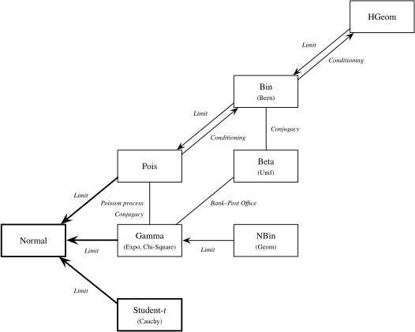

> 在这一章中, 首先介绍随机变量和分布的相关概念, 再介绍示性随机变量这一常见技巧, 最后对各种常见分布及其关系进行讨论
## RVs and Distributions

### RVS

随机变量是从样本空间 $S$ 到实数 $R$ 的函数, $X=X(\omega)$, 用于刻画我们真正关心的统计量. 

随机变量按照其性质分为离散型随机变量和连续型随机变量.

### Distributions

对于一个随机变量, 我们希望用一些概率学语言来刻画它的行为, 比如我们可能希望得到随机变量取值落入一段特定区间的概率. 而随机变量的分布就是这种概率学语言, 我们可以通过一些等价的方式来表达分布, 例如累计分布函数($CDF$), 概率质量函数($PMF$)(离散型), 概率密度函数($PDF$)(连续型).

### CDF

累计分布函数, 可以刻画所有类型随机变量的分布, 被定义为 $F_X(x)=P(X\leq x)$.

合法的 $CDF$ 需要满足以下的性质:
1. 单调性, if $x_1\leq x_2$, then $F(x_1)\leq F(x_2)$ 
2. 右连续, CDF可能存在跳点, 但始终右连续, $F(a)=\lim_{x\to a^+} F(x)$ 
3. 收敛性, $\lim_{x\to -\infty}F(x)=0, \lim_{x\to \infty} F(x)=1$ 

如果随机变量的 $CDF$ 是可微的, 或仅在有限个点处连续不可微时, 则此时随机变量为连续型随机变量.

### PMF

概率质量函数, 经常用于刻画离散型随机变量的分布, 被定义为 $p_X(x)=P(X=x)$.

合法的 $PMF$ 需要满足以下的性质:
1. 非负性, $p_X(x)>0$ if $x=x_j$ for some $j$, $p_X(x)=0$ otherwise
2. 和为 $1$, $\sum^\infty_{j=1}p_X(x_j)=1$

### PDF

概率密度函数, 用于刻画连续型随机变量的分布, 被定义为 CDF 的导数 $f(x)=F^{'}(x)$, 由于 $CDF$ 单调不减, 则对于支撑集内的 $x$, 有 $f(x)>0$, 而从 $PDF$ 到 $CDF$ 的转换为积分式 $F(x)=\int^x_{-\infty} f(t)\,dt$.

合法的 $PDF$ 需要满足以下的性质:
1. 非负性, $f(x)\geq 0$
2. 积分到1, $\int^\infty_{-\infty}f(x)\, dx=1$ 

概率密度函数与概率质量函数相比, 无法刻画 RV 在具体某个取值上的概率, 对于连续型随机变量而言, 永远有 $P(X=x)=0$, 不过可以用 $f(x)\,dx$ 刻画随机变量取值落入 $dx$ 这一微小区间上的概率

---
## Indicator Random Variable

### Definition

示性随机变量 $I_A$ 是反映某个事件 $A$ 是否发生的随机变量, 若 $A$ 发生, 则 $I_A$ 取 $1$, 反之取 $0$.

### Properties

示性随机变量有一些常见的性质, 假设 $A, B$ 是两个事件:
1. $(I_A)^k=I_A$
2. $I_{A^c}=1-I_A$ 
3. $I_{A\cap B}=I_A I_B$
4. $I_{A\cup B}=I_A+I_B-I_AI_B$

此外, 示性随机变量最重要的性质是: $P(A)=E(I_A)$, 这使得其可以作为概率和期望之间的桥梁. 再结合期望的线性性质, 这使得示性随机变量在期望的计算中十分有用: 一种常见的技巧是将随机变量 $X$ 分解为多个示性随机变量 $I_{X_i}$ 的和.

### Example

期望与生存函数($S(x)=1-F(x)=P(X>x)$)关系:
对任意非负随机变量 $X$, 有

$$
E(X)=\int^\infty_0 S(x)\,dx
$$

证明如下:

$$
X=\int^\infty_0I(X>x)\,dx \Rightarrow E(X)=E(\int^\infty_0I(X>x)\,dx)
$$

由 $Tonelli$ 定理, $E(\int \cdot \,dx)=\int E(\cdot) \,dx$ 可得 

$$
E(X)=\int^\infty_0 E(I(X>x))\,dx=\int^\infty_0 S(x)\,dx
$$

---
## Some Discrete Distributions

### Bernoulli

如果随机变量 $X$ 具有以下特征: 对于参数 $p\in (0,1)$, 有$P(X=1)=p, P(X=0)=1-p$, 则称 $X$ 服从 $Bernoulli$ 分布, 记作 $X \sim Bern(p)$ .

事实上, 上面介绍的示性随机变量就服从 $Bernoulli$ 分布. 反过来, 如果一个试验的结果只有成功和失败两种, 则被称为 $Bernoulli$ 试验, 而任何一个服从 $Bernoulli$ 分布的随机变量都可以认为是一个 $Bernoulli$ 试验的示性随机变量.
### Binomial

假设有 $n$ 次独立且成功概率均为 $p$ 的 $Bernoulli$ 试验, $X$ 刻画成功的次数, 则 $X$ 的分布被称作参数为 $n,p$ 的 $Binomial$ 分布, 记作 $X \sim Bin(n,p)$.

对于 $X \sim Bin(n,p)$: 
1. 我们可以很轻易求出其 $PMF$ 为 $P(X=k)=\binom{n}{k}p^k(1-p)^{n-k}$ (从 $n$ 次试验中选择 $k$ 次试验成功)
2. $X$ 可以分解为 $n$ 个示性随机变量$X_i \sim Bern(p)$的和, 因而 $E(X)=nE(X_1)=nP(X_1=1)=np$, 而由于这些示性随机变量是独立的, 还能有 $Var(X)=nVar(X_1)=np(1-p)$ (具体原理在 [Mathematical Properties of RVs](/note/mathematics/probability/mathematical-properties-of-rvs/) 的 [Covariance](/note/mathematics/probability/mathematical-properties-of-rvs/#covariance) 节中介绍)
### Geometric

在 $Binomial$ 的情景下, $X$ 刻画第 $1$ 次试验成功时进行的试验次数, 则 $X$ 服从以 $p$ 为参数的 $Geometric$ 分布, 记作 $X \sim Geom(p)$. (在部分教材中, 会将其称为 $First Success$ 分布, 而将 $X$ 刻画失败的次数服从的分布称为 $Geometric$ 分布).

对于 $X \sim Geom(p)$:
1. $Geom$ 分布的 $PMF$ 可直接求出为 $P(X=k)=p(1-p)^{k-1}, k\geq 1$
2. 期望 $E(X)$ 可以采取递推的方式计算. 考虑第一次试验有 $E(X)=p\cdot 1+(1-p)(1+E(X))$, 解得 $E(X)=\frac{1}{p}$, 方差使用 $E(X^2)-(E(X))^2$ 计算得到 $Var(X)=\frac{(1-p)}{p^2}$

### Negative Binomial

扩展 $Geometric$ 的情境, $X$ 刻画第 $r$ 次试验成功时进行的试验次数, 则 $X$ 服从以 $r, p$ 为参数的 $Negative\, Binomial$ 分布, 记作 $X\sim NBin(r,p)$. (同样, 在部分教材中, 会采取 $X$ 刻画失败次数服从的分布作为 $Negative\, Binomial$分布)

对于 $X\sim NBin(r,p)$:
1. 当 $X=k$ 时, 即第 $k$ 次试验成功, 且前 $k-1$ 次试验中有 $r-1$ 次成功, 则 $PMF$ 为 $P(X=k)=\binom{k-1}{r-1}p^r(1-p)^{k-r}$
2. 将 $X$ 分解为 $r$ 个独立随机变量 $X_i,i=1,2,...,r$ 之和, 其中 $X_i \sim Geom(p)$, 则 $E(\sum X_i)=\sum E(X_i)=\frac{r}{p}$, 同时有 $Var(\sum X_i)=\sum V(X_i)=\frac{r(1-p)}{p^2}$

### Poisson

$Poisson$ 分布经常被用于模拟大量试验中小概率事件成功的次数, 参数 $\lambda$ 一般可看作单位时间内小概率事件发生的次数(成功率), 记作 $X\sim Pois(\lambda)$. 

严格用 $PMF$ 来定义 $Poisson$ 分布:
$$
P(X=k)=\frac{e^{-\lambda}\lambda^k}{k!}, k=0,1,2,...
$$

使用级数相关数学工具, 可以求出 $X\sim Pois(\lambda)$ 的期望 $E(X)$ 和 方差 $Var(X)$:

$$
E(X)=e^{-\lambda}\sum^{\infty}_{k=0}k\frac{\lambda^k}{k!}=\lambda e^{-\lambda}\sum^{\infty}_{k=1}\frac{\lambda^{k-1}}{(k-1)!}=\lambda
$$

$$
Var(X)=E(X^2)-(E(X))^2=e^{-\lambda}\sum^{\infty}_{k=0}k^2\frac{\lambda^k}{k!}-(E(X))^2=\lambda(\lambda+1)-\lambda ^2=\lambda
$$

独立 $Poisson$  分布之和还是 $Poisson$ 分布: $X\sim Pois(\lambda_1), Y\sim Pois(\lambda_2), X+Y \sim Pois(\lambda_1+\lambda_2)$ 其中 $X$ 和 $Y$ 相互独立. 证明如下:
$$
P(X+Y=k)=\sum^k_{j=0}P(X+Y=k|X=j)P(X=j)=\sum^k_{j=0}\frac{e^{-\lambda_2}{\lambda_2^{k-j}}}{(k-j)!}\frac{e^{-\lambda_1}\lambda_1^j}{j!}=\frac{e^{-(\lambda_1+\lambda_2)}(\lambda_1+\lambda_2)^k}{k!}
$$

#### Poisson and Binomial

条件分布 $X|X+Y=n$ 服从 $Bin(n,\lambda_1/(\lambda_1+\lambda_2))$, 其中 $X\sim Pois(\lambda_1), Y\sim Pois(\lambda_2)$. 使用贝叶斯定理即可证明 

$$
P(X=k|X+Y=n)=\frac{P(X+Y=n|X=k)P(X=k)}{P(X+Y=n)}
$$

此外, 正如前面 "$Poisson$ 分布经常被用于模拟大量试验中小概率事件发生的次数", 当 $Binomial$ 分布的 $n \to \infty ,\, np=\lambda$ 时, $Binomial \to Poisson$, 代数上的证明是:

$$
\begin{aligned}
P(X=k)
&= \binom{n}{k}p^k(1-p)^{n-k} \\
&= \frac{n(n-1)\cdots(n-k+1)}{k!}
\left(\frac{\lambda}{n}\right)^k
\left(1-\frac{\lambda}{n}\right)^n
\left(1-\frac{\lambda}{n}\right)^{-k} \\
&= \frac{\lambda^k}{k!}\frac{n(n-1)\cdots(n-k+1)}{n^k}
\left(1-\frac{\lambda}{n}\right)^n
\left(1-\frac{\lambda}{n}\right)^{-k} \\
& \to \frac{e^{-\lambda}\lambda^k}{k!}\, (as \,\, n\to \infty) 
\end{aligned} 
$$

### Hypergeometric

考虑罐子里有 $w$ 个白球和 $b$ 个黑球, 从中抽取 $n$ 个球, 用 $X$ 刻画 $n$ 个球中白球的个数, 此时 $X$ 服从 $Hypergeometric$ 分布, 记作 $X \sim HGeom(w,b,n)$ 

对于 $X \sim HGeom(w,b,n)$:

1. 其 $PMF$ 为

$$
P(X=k)=\frac{\binom{w}{k}\binom{b}{n-k}}{\binom{w+b}{n}}
$$

2. 通过示性随机变量的技巧, 不难证明出 $E(X)=n\frac{w}{w+b}$
3. 当 $Hypergeometric$ 的 $(w+b)$ 非常大, 且 $(\frac{w}{w+b})$ 基本稳定时, $HGeom(w,b,n)\to Bin(n,\frac{w}{w+b})$
4. $HGeom(w,b,n)$ 和 $HGeom(n,w+b-n,w)$ 是完全相同的一种分布, 代数的视角计算化简 $PMF$ 不难证明这一点, 此外也可以采取思想实验, 将 `黑白` 与 `是否取出` 视为两种标签, 第二种写法可以描述为在 $n$  个 `取出` 和 $w+b-n$ 个 `非取出` 的球中选出 $w$ 个标 `白色`. 而两种写法中 $X$ 均为有 `取出` 和 `白色` 两个标签的球的个数.

### Negative Hypergeometric

在 $Hypergeometric$ 的情景下, 考虑抽取到出现第 $r$ 个白球为止时, $X$ 为此时黑球的个数, 称 $X$ 服从 $Negative \, Hypergeometric$ 分布, 写作 $X \sim NHGeom(w,b,r)$

对于 $X \sim NHGeom(w,b,r)$

1. 对于抽取完所有球后的黑白顺序, 出现第 $r$ 个白球时出现了 $k$ 个黑球意味着, $w+b$ 个位置中, 前 $r+k-1$ 个位置里有 $r-1$ 个白球, 后 $w+b-r-k$ 个位置中有 $w-r$ 个白球, 因而 $PMF$ 为

$$
P(X=k)=\frac{\binom{r+k-1}{r-1}\binom{w+b-r-k}{w-r}}{\binom{w+b}{w}}
$$

2. 考虑示性随机变量 $X_i$ 为第 $i$ 个黑球在第 $r$ 个白球之前, 则 $X=\sum^{b}_{i=1}X_i$ , 对于任意一个 $X_i$, 考虑第 $i$ 个黑球和所有白球的排列, 注意到 $P(X_i=1)=\frac{r}{w+1}$, 则有 $E(X)=\frac{rb}{w+1}$

---

## Some Continuous Distributions

### Uniform

$Uniform$ 是一段区间 $(a,b)$ 上均匀的分布, 其 $PDF$ 为 $f(x)=\frac{1}{b-a}, (a<x<b)$, CDF为 $F(x)=\frac{x-a}{b-a}, (a<x<b)$(均忽略了区间之外的部分).

对于 $X\sim Unif(a,b)$, 显然有 $E(X)=\frac{a+b}{2}$, 利用 $Var(X)=E(X^2)-(E(X))^2$ 并用积分求解 $E(X^2)$ 可以得到 $Var(X)=\frac{(b-a)^2}{12}$

$Uniform$ 分布很重要的一个性质是普遍性 ($Universality$), 即我们可以从 $U\sim Unif(0,1)$ 出发, 构造出服从任意连续型分布的随机变量, 反过来, 我们也可以从任意连续型随机变量出发构造出 $U\sim Unif(0,1)$. 假设 $F$ 是一个连续单增 $CDF$(保证有反函数), 用形式化的语言描述构造方式:

$$
\begin{aligned}
&Let \ U\sim Unif(0,1), \ and\ X=F^{-1}(U).\ Then\ X\ is\ an\ r.v.\ with\ CDF\ F \\
&Let \ X\ be\ an\ r.v.\ with\ CDF\ F.\ Then\ F(X)\sim Unif(0,1)
\end{aligned}
$$
该构造方式只需牢牢把握 $CDF$ 的定义, 并使用反函数的性质即可证明正确性.

### Normal

$Normal$ 分布在统计学中被广泛使用, 由于中心极限定理(具体原理在 [Central Limit Theorem](/note/mathematics/probability/inequalities-and-limit-theorems/#central-limit-theorem) 中介绍), 大量独立同分布的随机变量之和会趋近于 $Normal$ 分布, 因而其在自然界中广泛出现.

标准正态分布的 $PDF$ 为 $\varphi(x)=\frac{1}{\sqrt{2\pi}}e^{-x^2/2},x\in(-\infty,\infty)$, $CDF$ 由 $PDF$ 积分得到为 $\Phi(x)=\int^x_{-\infty}\varphi(t)\, dt=\int^x_{-\infty}\frac{1}{\sqrt{2\pi}}e^{-t^2/2}\,dt$. 当 $x\to\infty$ 时, $\Phi(x)$ 即变为高斯积分, 使用二重积分的技巧可以计算得到 $\Phi=1$.

正态分布的参数一般为随机变量的期望与方差, 随机变量服从正态分布记为 $X\sim N(\mu,\sigma^2)$, 其中 $\mu,\sigma^2$ 分别为 $E(X), Var(X)$, 对于标准正态分布, $E(X)=\int^{\infty}_{-\infty}x\varphi(x)\,dx=0 , Var(X)=\int^{\infty}_{-\infty}x^2\varphi(x)\,dx=-\int^{\infty}_{-\infty}x d\frac{1}{\sqrt{2\pi}}e^{-x^2/2}=1$,则随机变量服从标准正态分布记为 $X\sim N(0,1)$.

标准正态分布具有很好的对称性，具体包括：
1. $PDF$ 的对称性, $\varphi(x)=\varphi(-x)$
2. 尾部区域的对称性,有 $\Phi(x)=1-\Phi(-x)$
3. 随机变量的对称性, 若 $X\sim N(0,1)$, 则有 $-X\sim N(0,1)$

一般的 $Normal$ 分布可以由标准正态分布经过 $Shifting\, and\, Scaling$ 得到, 即$X\sim N(\mu,\sigma^2),X=\mu+\sigma Z,Z\sim N(0,1)$, 则其性质可以由 $\frac{X-\mu}{\sigma}\sim N(0,1)$ 得到.

### Exponential

假设单位时间内发生某事件的次数为 $\lambda$ , 则刻画该事件第一次发生所需时间的随机变量 $X$ 服从以 $\lambda$ 为参数的 $Exponential$ 分布, 记作 $X\sim Expo(\lambda)$(有部分教材会以 $\beta=\frac{1}{\lambda}$ 作为参数)

使用 $PDF$ 严格定义 $Exponential$ 分布: 如果一个连续型随机变量 $X$ 有 $PDF$ 为 $f(x)=\lambda e^{-\lambda x}$, 那么则称 $X$ 服从以 $\lambda$ 为参数的 $Exponential$ 分布.

$Exponential$ 分布与 $Geometric$ 分布和 $Poisson$ 分布都有紧密的联系, 在后文 [Exponential and Geometric](#exponential-and-geometric) 与 [Exponential and Poisson](#exponential-and-poisson) 会详细介绍.

#### Memoryless 

$Exponential$ 分布最重要的性质之一是无记忆性, 即随机变量 $X$ 满足 $P(X\geq s+t | X\geq s)=P(X\geq t)$ 对所有 $s,t\geq0$ 成立.直观理解这个性质, 对于某个事件的发生, 已经等待的时间不会给出还需要等待的时间的任何信息.

无记忆性为 $Exponential$ 分布在事件上的条件期望带来较为有趣的性质, 例如 $E(X|X\geq s)=s+E(X)=s+\frac{1}{\lambda}$

$Exponential$ 分布是 $(0,\infty)$ 上唯一具有无记忆性的连续型分布, $Geometric$ 分布是唯一具有无记忆性的离散型分布, 可以使用生存函数 $S$ 作严格证明. 

#### Exponential and Geometric

$Exponential$ 可以视为 $Geometric$ 分布在连续情况下的推广.下面展示一种不严谨的推导说明这一点 (严谨推导应当使用 $CDF$ 的逐点收敛与连续性蕴含分布收敛): 

考虑服从 $X\sim Geom(p)$, 其 $PMF$ 

$$
P(X=k)=p(1-p)^{k-1}
$$

做变量替换引入量纲伸缩, 即令 $Y=X \Delta_t, \lambda\Delta_t=p$ 并代入, 得到

$$
P(Y=y)=P(X\Delta_t=y)=P(X=\frac{y}{\Delta_t})=\lambda\Delta_t(1-\lambda\Delta_t)^{\frac{y}{\Delta_t}-1}
$$

换算为密度函数

$$
f_Y(y)=\frac{P(Y=y)}{\Delta_t}=\lambda(1-\lambda\Delta_t)^{\frac{y}{\Delta_t}-1}
$$

又由于当 $\Delta_t\to0$时 $(1-\lambda\Delta_t)^{\frac{1}{\lambda\Delta_t}}\to e^{-1}$, 则有

$$
f_Y(y)\to\lambda e^{-\lambda y}
$$

从 $Exponential$ 分布与 $Geometric$ 的关系出发, 我们可以类比的得到, $X\sim Expo(\lambda)$ 的期望 $E(X)=\frac{1}{\lambda}$, 方差 $Var(X)=\frac{1}{\lambda^2}$, 当然, 使用定义法计算也可以轻易得到.

#### Exponential and Poisson

$Exponential$ 和 $Poisson$ 被用于对 $Poisson$ 过程的两种不同统计量进行刻画. 而 $Poisson$ 过程描述这样一类连续时间事件发生的过程, 满足以下两个条件:
1. 刻画发生在一段长度为 $t$ 的时间区间上事件数量的随机变量服从 $Pois(\lambda_t)$ 分布
2. 刻画发生在不重叠的时间区间上事件数量的随机变量之间相互独立

下面说明 $Exponential$ 分布和 $Poisson$ 分布之间的联系

设随机变量 $T$ 刻画从开始时刻到第一次事件发生的时间, 随机变量 $N_t$ 刻画$(0,t)$ 内事件发生的次数. 由 $Poisson$ 分布的定义, 显然有 $N_t\sim Pois(\lambda_t)$

考虑 $T>t$ 即第一次事件发生时的时间大于 $t$, 该事件显然等价于另一种表述, 即在 $(0,t)$ 内事件发生的次数为 $0$.

于是有 

$$
P(T>t)=P(N_t=0)=\frac{e^{-\lambda t}(\lambda t)^0}{0!}=e^{-\lambda t}
$$

进一步得到 $P(T\leq t)=1-e^{-\lambda t}$, 则 $T\sim Expo(\lambda)$

### Gamma

$Gamma$ 分布是一种由 $Exponential$ 分布生成的分布. 服从 $Exponential$ 分布的随机变量一般刻画事件第一次发生需要的时间, 而服从 $Gamma$ 分布的随机变量刻画事件发生多次需要的时间, 若发生的次数为 $n$, 单位时间内发生事件的次数为 $\lambda$, 则此时随机变量服从以 $a,\lambda$ 为参数的 $Gamma$ 分布, 记为$X\sim Gamma(n,\lambda)$. (同样, 有部分教材会以 $\beta=\frac{1}{\lambda}$ 作为参数, 记为 $X\sim Gamma(n,\beta)$)

使用 $PDF$ 严格定义以 $a,1$ 为参数的 $Gamma$ (其中 $a$ 取值范围是正实轴). 对于 $X\sim Gamma(a,1)$, 有 

$$
f_X(x)=\frac{1}{\Gamma(a)}x^ae^{-x}\frac{1}{x}, x>0
$$

再使用 $scaling$ 得到服从一般 $Gamma$ 分布随机变量的 $PDF$ : 如果单位时间内发生事件的次数由 $1$ 变为 $\lambda$, 则等待相同次数发生所需的时间变为原来的 $\frac{1}{\lambda}$, 即 $Y=\frac{X}{\lambda}\sim Gamma(a,\lambda)$, 并且有 

$$
f_Y(y)=f_X(x)|\frac{dx}{dy}|=\frac{1}{\Gamma(a)}(\lambda y)^ae^{-\lambda y}\frac{1}{y}, y>0
$$

对于 $X\sim Gamma(a,\lambda), Y\sim Gamma(b,\lambda)$, 其中 $X,Y$ 相互独立
1. 先考虑 $W\sim Gamma(a,1)$, 使用期望的定义与 $\Gamma$ 函数的定义, 不难计算得到 $E(W)=\frac{\Gamma(a+1)}{\Gamma(a)}=a$, $Var(W)=\frac{\Gamma(a+2)}{\Gamma(a)}-(E(W))^2=a$. 又由 $X=\frac{W}{\lambda}$, 进而得到 $E(X)=\frac{a}{\lambda}$, $Var(X)=\frac{a}{\lambda^2}$. 当然较为不严谨地将 $X$ 分解为 $a$ 个(事实上 $a$ 不为整数时无法这样分解)服从 $Exponential$ 分布的独立随机变量相加可以得到相同结果
2. 当 $a$ 取值为整数, 即 $a=n, n\in Z^*$ 时, 对于 $X_1+X_2+...+X_n\sim Gamma(n,\lambda)$, 其中 $X_i\sim Expo(\lambda)$ 的严格分析学证明可以使用矩母函数进行证明 (随机变量的矩母函数决定随机变量服从的分布, 将在 [Mathematical Properties of RVs](/note/mathematics/probability/mathematical-properties-of-rvs/) 的 [Moment](/note/mathematics/probability/mathematical-properties-of-rvs/#moment) 节中介绍)
3. $Gamma$ 分布对独立求和封闭, 且尺度参数不变, 形状参数求和, 即 $X+Y\sim Gamma(a+b,\lambda)$, 直观来讲, $X+Y$ 可以解释为先后等 $a,b$ 次事件发生所需的时间之和, 等价于 $a+b$ 次事件发生所需的时间, 即服从 $Gamma(a+b,\lambda)$. 严格的证明可以通过[卷积](/note/mathematics/probability/transformations/#convolution)完成.

#### Gamma and Poisson

$Gamma$ 和 $Poisson$ 具有共轭关系($conjugate$).

共轭关系是**统计学**概念, 主要刻画这样一种数学性质: 在对一个概率模型的未知参数进行 $Bayesian$ 推断时, 给参数选定一个先验分布, 观测数据后通过 $Bayes$ 定理得到的后验分布, 与先验分布属于同一种分布簇, 此时先验为该似然的共轭先验.

对于待推断 $Poisson$ 分布中的参数 $\lambda$ (单位时间内事件的发生次数), 选定 $Gamma$ 分布作为先验, 即 $\lambda \sim Gamma(r_0,b_0)$. 接着在一段 $t$ 长度的时间内观测随机变量 $Y|\lambda\sim Pois(\lambda t)$, 根据 $Y=y$ 与贝叶斯公式更新 $\lambda|Y=y$ 的分布. 具体推导过程如下:

$$
\begin{aligned}
f(\lambda|Y=y) &=\frac{P(Y=y|\lambda)f(\lambda)}{\int_0
^\infty P(Y=y|\lambda)f(\lambda)\,d\lambda} \\
& \propto e^{-(b_0+t)\lambda}\lambda^{r_0+y}\frac{1}{\lambda} \\
& \Rightarrow \lambda|Y=y \sim Gamma(r_0+y,b_0+t) 
\end{aligned} 
$$
在这个场景下, $Gamma$ 分布的两个参数 $(\alpha,\beta)$ 可以理解为 $($事件次数信息, 时间信息$)$

### Beta

$Beta$ 分布是区间 $(0,1)$ 上的连续分布, 由 $Unif(0,1)$ 分布生成, 使得区间内的 $PDF$ 可以偏离常值. 使用 $PDF$ 严格定义 $Beta$ 分布, 若随机变量 $X$ 有 $PDF$ : 

$$
f(x) =\frac{1}{B(a,b)}x^{a-1}(1-x)^{b-1}
$$
则称 $X$ 服从以 $a,b$ 为参数的 $Beta$ 分布, 记作 $X\sim Beta(a,b)$, 当 $a=b=1$ 时, $Beta$ 分布退化为 $Unif(0,1)$

#### Beta and Binomial

同 $Gamma$ 和 $Poisson$ 一样, $Beta$ 和 $Binomial$ 也具有共轭关系.

对于待推断 $Binomial$ 分布中的参数 $p$ (试验成功的概率), 选定 $Beta$ 分布作为先验, 即 $p\sim Beta(a,b)$ ($Beta$ 分布在区间 $(0,1)$ 上, 非常适合作为概率的估计) , 接着在 $n$ 次试验中观测随机变量 $X|p\sim Bin(n,p)$, 根据 $X=k$ 与贝叶斯公式更新 $p|X=k$ 的分布. 具体推导过程如下:

$$
\begin{aligned}
f(p|X=k) &=\frac{P(X=k|p)f(p)}{\int^1_0 P(X=k|p)f(p)\,dp} \\
& \propto p^{a+k-1}(1-p)^{b+n-k-1} \\
& \Rightarrow p|X=k \sim Beta(a+k,b+n-k)
\end{aligned}
$$
在这个场景下, $Beta$ 分布的两个参数 $(a,b)$ 可以理解为 $($成功次数, 失败次数$)$

### Cauchy

$Cauchy$ 分布同 $Normal$ 分布一样 $PDF$ 呈一条钟形曲线, 但尾部更厚, 极端值更容易出现, 使得 $Cauchy$ 分布的期望与方差不收敛. $Cauchy$ 分布常用于刻画某些随机比值的统计量, 事实上 $Cauchy$ 分布最经典的来源是两个 $Normal$ 分布的比值.

假设 $X,Y\sim N(0,1)$, 其中$X,Y$ 相互独立. 考虑 $T=\frac{X}{Y}$ 的 $CDF$ :

$$
\begin{aligned}
F_T(t)&=P(T\leq t)=P(\frac{X}{Y}\leq t)=P(\frac{X}{|Y|}\leq t) \\
&=P(X\leq t|Y|)=\int^\infty_{-\infty}P((X\leq t|Y|)|Y=y)f_Y(y)dy \\
&=\int^\infty_{-\infty}\frac{1}{\sqrt{2\pi}}e^{-y^2/2}\Phi(t|y|)dy
\end{aligned}
$$
进而求导计算其 $PDF$ 可得到 :

$$
f_T(t)=\sqrt{\frac{2}{\pi}}\int^\infty_0\frac{\partial}{\partial t}(e^{-y^2/2}\Phi(ty))dy=\frac{1}{\pi(1+t^2)}
$$
此时称 $T$ 服从以 $0,1$ 为参数的 $Cauchy$ 分布, 记为 $T\sim Cauchy(0,1)$,  对于一般的 $Cauchy$ 分布, 使用 $shifting\,and\,scaling$ 可以得到 $T\sim Cauchy(t_0,\gamma)$ 的 $PDF$ 为 :

$$
f_T(t)=\frac{1}{\pi\gamma}\frac{1}{1+(\frac{t-t_0}{\gamma})^2}
$$
两个参数分别刻画 $PDF$ 曲线的中轴与曲线的横向分散程度

#### Stability

如果对于任意 $n$ 个 $i.i.d$ 样本 $X_i$, 总能找到 $a_n,b_n$ 使得 $\frac{1}{n}\sum X_i \overset{d}{=} a_nX+b_n$, 则称随机变量 $X$ 服从的分布具有稳定性. 

$Normal$ 分布和 $Cauchy$ 分布是两种经典的稳定分布,有:

$$
\begin{aligned}
& X_i\sim N(\mu,\sigma^2), \bar{X}_n\sim N(\mu,\frac{\sigma^2}{n}) \\
& X_i\sim Cauchy(x_0,\gamma),\bar{X}_n\sim Cauchy(x_0,\gamma)
\end{aligned}
$$

可以看到 $Cauchy$ 分布取平均后还展现出与其他分布不同的现象 : 分布并没有向中心值集中, 即极端值的影响没有被平均操作消除. 这使得 $Cauchy$ 分布成为稳定分布理论中非常典型的特例.

### Chi-Square

$Chi-Square$ 分布常用于衡量一组随机偏差的总平方量, 考虑 $Z_i\sim N(0,1)$ 为一个独立方向上的标准化偏差, 则 $V=\sum Z_i^2$ 就是这些偏差的总平方量, 有 $V\sim\chi_n^2$. $Chi-Square$ 的另一种解释与欧式空间中的距离有直接的关系: 高维标准正态随机向量的长度平方服从的分布.

$Chi-Square$ 分布中自由度刻画经典情况下参与求和的独立标准正态分量的个数, 对于非经典情况, 自由度并非总是参与求和的正态分量个数.
#### Chi-Square and Gamma

$Chi-Square$ 分布实际上是 $Gamma$ 分布的一种特例, 可以从 $Z_1^2\sim \chi_1^2$  和 $Gamma(\frac{1}{2},\frac{1}{2})$ 等价出发, 进而通过 $Gamma$ 分布对独立求和的封闭性推出 $\chi_n^2 \cong Gamma(\frac{n}{2},\frac{1}{2})$, 下面通过 $PDF$ 证明简单情形的等价:

$$
\begin{aligned}
F(x) & =P(Z_1^2\leq x)=P(-\sqrt{x}\leq Z_1 \leq \sqrt{x})\\
& =\Phi(\sqrt{x})-\Phi(-\sqrt{x})=2\Phi(\sqrt{x})-1 \\
& \Rightarrow f(x) =\frac{d}{dx}F(x)=\varphi(\sqrt x)x^{-1/2} \\
& =\frac{1}{\sqrt{\pi}}(\frac{x}{2})^{1/2}e^{-x/2}\frac{1}{x}=\frac{1}{\Gamma(\frac{1}{2})}(\frac{x}{2})^{1/2}e^{-x/2}\frac{1}{x} \\
& \Rightarrow Z_1^2\sim Gamma(\frac{1}{2},\frac{1}{2})
\end{aligned}
$$

而根据等价关系, 对于 $Z\sim \chi_n^2$, 我们很轻易地得到 $E(Z)=\frac{n/2}{1/2}=n, Var(Z)=\frac{n/2}{(1/2)^2}=2n$

### Student's t

$Student's\, t$ 分布, 也常被省略写作 $t$ 分布, 一般用于刻画随机偏差在一个随机尺度下服从的分布. 假设 $Z\sim N(0,1), V\sim \chi_n^2$, 其中 $Z,V$ 相互独立, 则 $T=\frac{Z}{\sqrt{V/n}}$ 服从标准 $t$ 分布, 记作 $T\sim t_n$. 在上述统计学场景中, $Z$ 即为随机偏差, $V/n$ 即为一个随机尺度因子 ($Chi-Square$ 分布在一定程度上是 $Normal$ 样本某种尺度的衡量)

$t$ 分布的 $PDF$ 计算具有较强的技巧性, 概括性地叙述是: 引入随机变量 $W=\sqrt{V/n}$, 再根据$f_{Z,V}(z,v)=f_Z(z)f_V(v)$ 再通过变量代换 (具体将在 [Transformations](/note/mathematics/probability/transformations/) 的 [Jacobian Transformation](/note/mathematics/probability/transformations/#jacobian-transformation) 一节中介绍) 得到 $f_{T,W}$, 进而求出 $Marginal$ 分布 $f_T$. 这里不具体展开计算过程, 标准 $t$ 分布的结果为 

$$
f_T(t)=\frac{\Gamma((n+1)/2)}{\sqrt{n\pi}\,\Gamma(n/2)}(1+t^2/n)^{-(n+1)/2}
$$
对标准 t 分布做 $shifting\, and\, scaling$  得到 $X=\sigma T+\mu$ 服从一般的 $t$ 分布, 记为 $X\sim t_n(\mu,\sigma)$

对于 $T\sim t_n(\mu,\sigma)$ :
1. 从上述 $t$ 分布 $PDF$ 的表达式可以看出, $T$ 具有对称性, 即 $-T$ 与 $T$ 关于 $x=\mu$ 对称
2. $Cauchy$ 分布实质上是 $t$ 分布的一种特例, 有 $Cauchy(\mu,\sigma) \cong t_1(\mu,\sigma)$
3. 当 $n\to \infty$ 时, 标准 $t$ 分布收敛到标准 $Normal$ 分布, 使用连续映射定理与 $Slutsky$ 定理(具体将在 [Convergence](/note/mathematics/probability/inequalities-and-limit-theorems/#convergence) 一节中介绍)(当 $n\to \infty$ 时, 服从$Chi-Square$ 分布的 $V$ 会趋向 $n$, 进而使分母趋向 $1$, 进而使分布最终收敛)

$t$ 分布与 $Chi-Square$ 分布在样本平均相关的随机变量中起到重要的刻画作用, 更具体的内容会在 [Inequalities and Limit Theorems](/note/mathematics/probability/inequalities-and-limit-theorems/) 的 [Random Sampling](/note/mathematics/probability/inequalities-and-limit-theorems/#random-sampling) 一节中介绍.

--- 

## Picture of Relationship between Distributions

