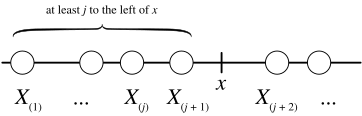
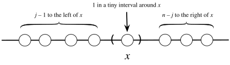

> 在实际问题中, 有时我们关心的问题并不简单由随机变量刻画, 而需要经过一系列变换. 这一章介绍的变换包括位置尺度变换, 坐标变换, 卷积和排序.

## Shifting and Scaling

> 也即位置尺度变换 ($Location-Scale$ $transformation$) 

$Shifting$ $and$ $Scaling$ 是对标准分布做一般化的常用变换, 同时也是下面 $Jacobian$ $Transformation$ 的线性变换情形. 

具体而言, 设 $X$ 是任意随机变量, 随机变量 $Y=\sigma X+\mu$, 则称 $Y$ 是 $X$ 的一个位置尺度变换, $\mu$ 控制位置变化, $\sigma$ 控制尺度变化. 下面以 $X$ 连续, $\sigma,\mu>0$ 的情形为例讨论该变化的性质.

首先讨论 $Y$ 的 $CDF$, 有 

$$
F_Y(y)=P(Y\leq y)=P((\sigma X+\mu)\leq y)=P(X\leq(\frac{y-\mu}{\sigma}))=F_X(\frac{y-\mu}{\sigma})
$$

再求导得到 $PDF$ 
$$
f_Y(y)=\frac{dF_Y(y)}{dy}=\frac{1}{\sigma}f_X\left(\frac{y-\mu}{\sigma}\right)
$$
依据期望与方差的性质有
$$
E(Y)=E(\sigma X+\mu)=\sigma E(X)+\mu, Var(Y)=\sigma^2Var(X)
$$

可以将其推广到随机向量情形, 随机向量 $Y=\Sigma X+\mu$, 联合分布的推导与下面 $Jacobian$ $Transformation$ 完全一致, 不再展开. 而期望与协方差矩阵有
$$
E(Y)=\Sigma E(X)+\mu, Cov(Y)=E((Y-E(Y))(Y-E(Y))^T)=\Sigma Cov(X)\Sigma^T
$$

$Location-Scale$ 变换中很重要的一个 $trick$ 是, 确定变换后的分布, 往往不需要重新推导整个分布, 只需要识别参数的变化. 例如 [Multivariate Random Variables](/note/mathematics/probability/multivariate-random-variables/) 对 $MVN$ 从 $N(0,\Sigma)$ 到 $N(\mu,A\Sigma A^T)$ 的推导, 见 [Transformation](/note/mathematics/probability/multivariate-random-variables/#transformation).

---
## Jacobian Transformation

$Jacobian$ $Transformation$ 采取类似于坐标变换的方式, 使用 $g(\cdot)$ 将随机向量 $X=(X_1,...,X_n)$ 变换到 $Y=(Y_1,...,Y_n)$, 对该变换的讨论依赖于分析学中的链式法则.

对于 $Y=g(X)$ , 其联合分布 $PDF$ 有
$$
f_Y(y)=f_X(g^{-1}(y))\left|\det\left(\frac{\partial x}{\partial y}\right)\right|
$$
其中 $\frac{\partial x}{\partial y}$ 是 $Jacobi$ 矩阵

$$
\frac{\partial x}{\partial y}=
\begin{pmatrix}
\frac{\partial x_1}{\partial y_1} &... & \frac{\partial x_1}{\partial y_n} \\
\vdots & &\vdots \\
\frac{\partial x_n}{\partial y_1} &... & \frac{\partial x_n}{\partial y_n}
\end{pmatrix}
$$

$Jacobian$ 变换中很重要的一个 $trick$ 是, 在求随机变量 $Z,W$ 联合分布时可以先求性质良好的 (例如独立性) $X,Y$ 的联合分布, 再通过 $Jacobian$ 变换得到 $Z,W$ 的联合分布. 例如 [Multivariate Random Variables](/note/mathematics/probability/multivariate-random-variables/) 对 $MVN$ 从 $N(0,I)$ 到 $N(0,\Sigma)$ 的推导, 见 [Transformation](/note/mathematics/probability/multivariate-random-variables/#transformation).

---
## Convolution

在实际问题中, 我们往往关注多个独立试验的和或均值, 因而有卷积的概念, 即独立随机变量之和.

对于 $T=X+Y$, 其中 $X,Y$ 独立, 若 $X,Y$ 为离散型随机变量, 则 $T$ 的 $PMF$ 为 :
$$
\begin{aligned}
P(T=t)&=\sum_x P(Y=t-x)P(X=x) \\
&=\sum_y P(X=t-y)P(Y=y)
\end{aligned}
$$
而若 $X,Y$ 为连续型随机变量, 则 $T$ 的 $PDF$ 为 :
$$
\begin{aligned}
f_T(t)&=\int_Sf_Y(t-x)f_X(x)\,dx \\
&=\int_{S^{'}}f_X(t-y)f_Y(y)\,dy
\end{aligned}
$$
本质是全概率公式在独立性条件下的特殊形式.

---

## Order Statistics

本章最后一个介绍的变换是排序, 将 $n$ 个随机变量 $X_1,...,X_n$ 变换到 $X_{(1)}=min(X_1,...,X_n)\leq...\leq X_{(n)}=max(X_1,...,X_n)$. $Order$ $Statistics$ 在我们考虑分布的极端值时发挥重要作用. 在这一节里, 我们只考虑较为简单的情形, 即假设 $n$ 个随机变量是[独立同分布](/note/mathematics/probability/inequalities-and-limit-theorems/#random-sampling)的.

我们先考虑 $X_{(1)}$ 和 $X_{(n)}$, 对于 $X_{(n)}$, 其 $CDF$ 有
$$
\begin{aligned}
F_{X_{(n)}}(x)&=P(max(X_1,...,X_n)\leq x)\\
&=P(X_1\leq x)...P(X_n\leq x) \\
&=(F(x))^n
\end{aligned}
$$
而对于 $X_{(1)}$, 其 $CDF$ 由生存函数有
$$
\begin{aligned}
F_{X_{(1)}}(x)&=1-P(min(X_1,...,X_n)\geq x)\\
&=1-P(X_1\geq x)...P(X_n\geq x)\\
&=1-(1-F(x))^n
\end{aligned}
$$
下面考虑更一般的情况

对于 $X_{(j)}\leq x$, 等价于 "至少有 $j$ 个随机变量落在数轴上 $x$ 的左边". 定义 $N$ 为 $X_i$ 落入 $x$ 左边的个数, 每个 $X_i$ 落入 $x$ 左边的概率为 $F(x)$, 则 $N\sim Bin(n,F(x))$

于是 $X_{(j)}$ 的 $CDF$ 为 :
$$
P(X_{(j)}\leq x)=\sum_{k=j}^{n}\binom{n}{k}F(x)^k(1-F(x))^{n-k}
$$

$X_{(j)}$ 的 $PDF$ 可以采用求导的方式求出. 但这里考虑 $f_{X_{(j)}}\,dx$ 的物理含义 : 第 $j$ 大的随机变量落入 $x$ 附近长度为 $dx$ 的区间中概率. 考虑过程: 
- 首先从 $n$ 个随机变量中选出一个以 $f(x)\,dx$ 的概率落入区间
- 从剩下的 $n-1$ 个随机变量中选出 $j-1$ 个以 $F(x)$ 概率落入 $x$ 的左边
- 最后的 $n-j$ 个随机变量以 $1-F(x)$ 概率落入 $x$ 右边

因而有 
$$
f_{X_{(j)}}(x)=nf(x)\binom{n-1}{j-1}F(x)^{j-1}(1-F(x))^{n-j}
$$